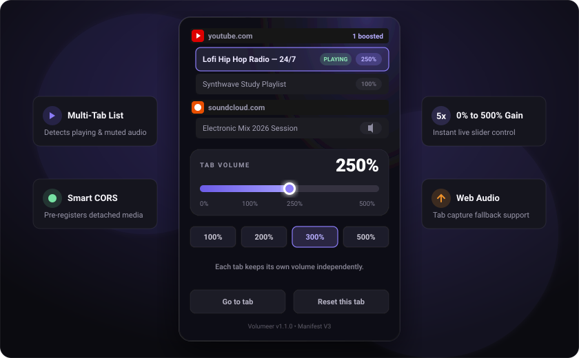
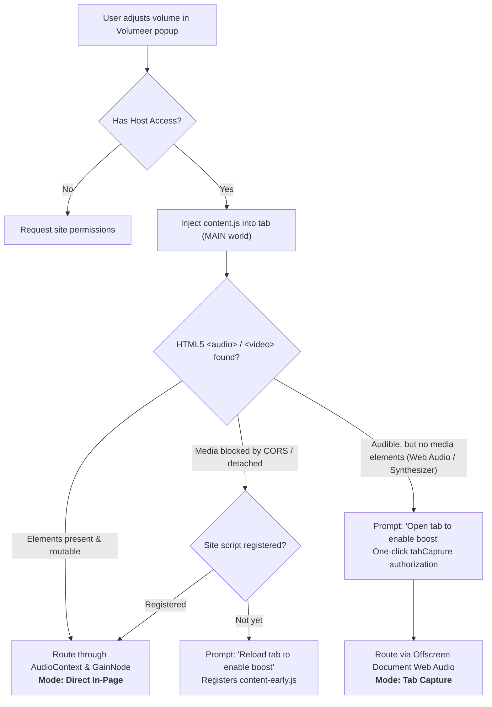

<div align="center">


# Volumeer

**Precision audio booster for Brave &amp; Chromium — amplify tab volume independently up to 500%**

*Per-tab volume management, smart CORS routing, domain grouping, and seamless Web Audio capture.*

<p>
  
  
  
  
  
</p>

---

<p>
  <a href="#-about-volumeer">About</a> •
  <a href="#-key-features">Features</a> •
  <a href="#-visual-tour">Visual Tour</a> •
  <a href="#-installation">Installation</a> •
  <a href="#-how-volumeer-works">How It Works</a> •
  <a href="#-usage-guide">Usage Guide</a> •
  <a href="#-project-architecture">Architecture</a> •
  <a href="#-testing--development">Testing</a> •
  <a href="#-icon--design-philosophy">Design</a> •
  <a href="#-license">License</a>
</p>

<p align="center">
  
</p>

</div>

---

## 🔊 About Volumeer

**Volumeer** is a lightweight, privacy-first Chromium and Brave browser extension that gives you master control over browser audio. Whether you are straining to hear quiet voices in an online lecture, leveling out podcasts, or adjusting background music while gaming, Volumeer boosts audio on a **strictly per-tab basis up to 500%** without distorting your global system volume.

Unlike typical volume booster extensions that blindly hijack the active tab or broadcast audio to unmonitored scripts, Volumeer operates with fine-grained precision:

- 🎚️ **Tab-Isolated Gain**: Amplify one tab to 250%, lower another to 60%, and keep a third muted at 0% — each tab retains its own setting independently.
- ⚡ **Zero Tab Switching**: Adjust any background tab's volume straight from the popup dashboard without leaving your current workspace.
- 🛡️ **100% Local &amp; Private**: Zero telemetry, zero analytics pings, and no external network calls. All audio routing and adjustments happen locally in memory.
- 🌐 **Intelligent 3-Tier Pipeline**: Automatically detects whether to route through direct HTML5 media nodes, early CORS pre-registration, or an offscreen Web Audio capture stream.

---

## ✨ Key Features

<table>
  <tr>
    <td width="50%">
      <h3>🎛️ Independent Volume Boost (0% – 500%)</h3>
      <p>Fine-tune volume from absolute silence (0%) to 5x standard output (500%) with live, responsive slider dragging and instant preset triggers.</p>
    </td>
    <td width="50%">
      <h3>📑 Smart Tab Discovery &amp; Grouping</h3>
      <p>Aggregates audible, boosted, and recently active tabs across all browser windows. Groups multiple tabs by domain under collapsible headers carrying favicons.</p>
    </td>
  </tr>
  <tr>
    <td width="50%">
      <h3>🔄 Automatic Reconnection &amp; State Memory</h3>
      <p>Retains gain settings across in-tab page navigation and saves active tab states in session storage so you never lose your audio balance.</p>
    </td>
    <td width="50%">
      <h3>🏷️ Dynamic Browser Action Badges</h3>
      <p>Displays real-time volume multipliers (e.g. <code>1.5x</code>, <code>2x</code>, <code>5x</code>) on the toolbar badge in electric violet whenever a tab is boosted.</p>
    </td>
  </tr>
  <tr>
    <td width="50%">
      <h3>⚡ Transparent In-Page Injection</h3>
      <p>Directly connects to DOM <code>&lt;audio&gt;</code> and <code>&lt;video&gt;</code> elements via Web Audio GainNodes without forcing tab focus or audio latency.</p>
    </td>
    <td width="50%">
      <h3>🎙️ Offscreen Web Audio Capture Fallback</h3>
      <p>Employs Manifest V3 offscreen documents and <code>tabCapture</code> to smoothly handle canvas games, Web Audio synthesizers, and complex streams.</p>
    </td>
  </tr>
</table>

---

## 📸 Visual Tour

### 1. Central Multi-Tab Control Panel
Oversee and manipulate audio streams across your entire browser. Collapsible domain headers show boosted tab counts, while live status pills indicate when a stream is actively playing, muted, or amplified.

<p align="center">
  
</p>

### 2. Intelligent Audio Pipeline Routing
Volumeer dynamically evaluates each tab's audio architecture to choose the least intrusive, highest-fidelity amplification path.

<p align="center">
  
</p>

### 3. Actionable Setup Prompts
For sites that require CORS pre-registration (such as SoundCloud) or direct tab capture (such as browser synthesizers), Volumeer provides clear, one-click prompts without ever jumping or reloading tabs unprompted.

---

## 🚀 Installation

Volumeer is packaged as an unpacked Manifest V3 extension ready for immediate use in Brave, Google Chrome, Microsoft Edge, and any Chromium-compatible browser.

### Step-by-Step Setup

1. **Clone or Download the Repository:**
   ```bash
   git clone https://github.com/projectGloria/Volumeer.git
   ```
   *(Alternatively, download and extract the repository ZIP archive).*

2. **Open Extensions in your Browser:**
   - In **Brave**: navigate to `brave://extensions`
   - In **Chrome / Chromium**: navigate to `chrome://extensions`

3. **Enable Developer Mode:**
   - Toggle the **Developer mode** switch in the top-right corner of the Extensions page.

4. **Load the Unpacked Folder:**
   - Click the **Load unpacked** button in the top-left toolbar.
   - Select the `Volumeer` directory.

5. **Pin Volumeer to Your Toolbar:**
   - Click the extension puzzle icon on your browser toolbar and pin **Volumeer** for instant one-click access.

---

## 💡 How Volumeer Works

Websites deliver audio in several fundamentally different ways. Volumeer handles each with a dedicated pipeline layer:



### 1. In-Page Injection (`content.js`)
When you select a tab, Volumeer injects a lightweight script into the page's `MAIN` world that connects all `<audio>` and `<video>` tags to a Web Audio `GainNode`. As you drag the popup slider, the gain adjusts in real-time without re-buffering or pausing playback.

### 2. Early CORS Pre-Registration (`content-early.js`)
Some modern web players (such as SoundCloud or Bandcamp) construct detached media elements in JavaScript before attaching them to the DOM, or stream audio from third-party CDNs without permissive CORS headers. 

When Volumeer encounters these, it prompts:
> **"Reload tab to enable boost"**

Accepting this registers a permanent per-site content script that executes at `document_start`, tagging newly instantiated media elements with `crossOrigin = "anonymous"`. Once reloaded, that site remains controllable on all future visits.

### 3. Offscreen Document Tab Capture (`offscreen.js`)
Pages that generate audio strictly through Web Audio graphs (browser games, software synths, WebAssembly engines) contain no `<audio>` or `<video>` DOM elements to hook into.

For these, Volumeer displays:
> **"Open tab to enable boost"**

Clicking this brings the tab to the foreground. Tapping the Volumeer toolbar icon once authorizes `chrome.tabCapture`, which streams the tab's sound through an isolated Manifest V3 offscreen document (`offscreen.html`), applying clean gain amplification.

> [!TIP]
> **Recommended Listening Level**: Begin boosting around **150% – 200%**. Extremely high gain levels (400%–500%) on audio that is already mastered loud can cause digital clipping.

> [!NOTE]
> Internal browser pages (e.g. `brave://settings`, `chrome://extensions`) and protected extension store domains are restricted by browser security policies and cannot be modified.

---

## 📖 Usage Guide

| Action | How to Perform |
| :--- | :--- |
| **Select a Tab** | Click any tab row in the popup list. The active tab is outlined in violet. |
| **Adjust Volume** | Drag the volume slider (0% to 500%) or click quick presets (**100%**, **200%**, **300%**, **500%**). |
| **Collapse / Expand Site** | Click any site heading (e.g. `youtube.com`) to collapse or expand its tab group. |
| **Jump to Tab** | Click the **Go to tab** button to bring the selected tab and its window immediately into focus. |
| **Reset Volume** | Click **Reset this tab** to return volume to standard 100% and release any active capture sessions. |
| **Mute Instantly** | Drag the slider to **0%**; the tab row pill immediately displays a mute speaker icon. |

---

## 📂 Project Architecture

```
Volumeer/
├── manifest.json          # Manifest V3 extension configuration & permissions
├── background.js          # Service worker managing state, capture sessions & badges
├── content.js             # In-page media element gain controller (MAIN execution world)
├── content-early.js       # Pre-registration script for detached media & CORS handling
├── offscreen.html         # Offscreen document host for tab audio capture
├── offscreen.js           # Web Audio gain graph manager for captured tab streams
├── popup.html             # Extension popup user interface
├── popup.css              # Dark theme styling, glassmorphism & responsive layout
├── popup.js               # Reactive tab list controller, domain grouping & slider logic
├── icon.png               # High-resolution (512x512) master artwork
├── icons/                 # Formatted extension icons (16px, 32px, 48px, 128px)
└── tests/                 # Automated test suite (Node.js test runner)
    ├── page-gain.test.cjs
    ├── pending-gain.test.cjs
    └── popup.test.cjs
```

---

## 🧪 Testing &amp; Development

Volumeer includes an automated unit test suite leveraging Node.js's native test runner (`node:test`) to verify state transitions, DOM manipulation, gain persistence, and tab grouping:

```bash
# Run the complete test suite
node --test tests/*.test.cjs
```

### Test Coverage Highlights
- ✔ Direct in-page media gain routing without unnecessary tab capture
- ✔ Automatic CORS fallback handling and early script registration
- ✔ Audible tab capture fallback for non-media Web Audio elements
- ✔ Cross-window multi-tab discovery and domain-level grouping
- ✔ Session storage persistence across tab navigation and popup closure
- ✔ Safe permission recovery and non-blocking slider dragging

---

## 🎨 Icon &amp; Design Philosophy

<p align="center">
  
</p>

Volumeer is styled with a sleek, distraction-free aesthetic tailored for modern dark-mode browser environments:

- **Deep Obsidian &amp; Charcoal**: Built on a `#111117` base with `#181821` panel layering to integrate seamlessly with Brave and dark desktop themes.
- **Electric Violet Accents**: Highlights and active status indicators use `#8b7cf8` and `#b9afff` for high-contrast legibility.
- **Adaptive Proportions**: The popup UI smoothly expands as tabs are opened up to the browser's 600px ceiling, preserving scroll position and pinning controls into view.

---

## 📜 License

Distributed under the **MIT License**. Free for personal and commercial use.

Crafted with care for the open web. Pull requests and feedback are welcome!
